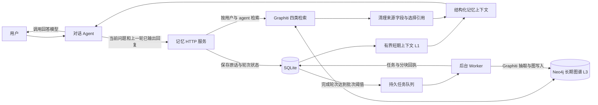
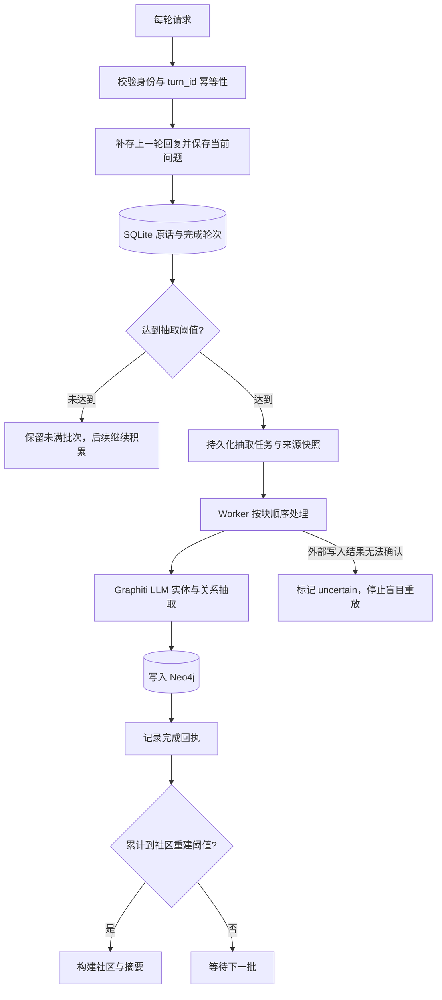
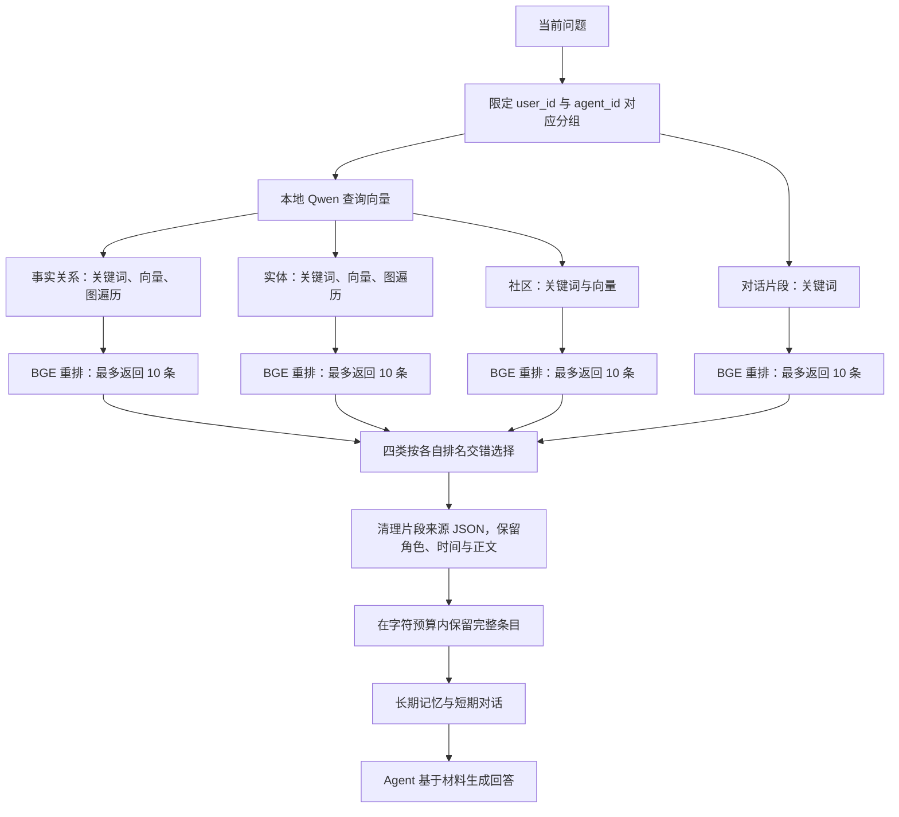

# Bumi_Mem

面向陪伴机器人与对话 Agent 的分层记忆服务：用 **SQLite 保存近期原话与持久任务**，用 **Graphiti + Neo4j 构建和检索长期知识图谱**，通过 HTTP 为 Agent 返回可直接使用的记忆上下文。

当前是 **Graphiti 实验版**。包版本为 `0.6.0`，主接口版本为 OpenAPI `1.4.0`。旧 Mem0 实现与测试保留用于历史对照，当前 Graphiti 服务不依赖 Mem0 或 Qdrant。

[快速启动](#快速启动) · [整体架构](#整体架构) · [检索流程](#检索流程) · [Agent 接入](#agent-接入) · [验证结果](#验证结果) · [文档导航](#文档导航)

## 能做什么

- **持续对话**：近期消息保存在 SQLite，进程重启后仍可恢复。
- **自动形成长期记忆**：默认每 10 个完成轮次提交一次后台抽取，达到 token 阈值也会提前提交。
- **图谱检索**：同时查询事实关系、实体、对话片段和社区，使用本地 embedding 与 BGE 重排。
- **时间信息保留**：展示来源时间及图谱事实的有效、失效时间，帮助区分历史状态和当前表达。
- **多用户作用域**：短期窗口按 agent 共享，直接长期查询按 `user_id + agent_id` 隔离。
- **单次 HTTP 接入**：每轮提交当前问题和上一轮已输出回复，返回结构化长期、短期记忆。
- **可检查的后台任务**：持久化任务状态、分块回执和社区构建水位；不把“已排队”当作“已记住”。

记忆服务负责保存、检索和组织材料。主 HTTP 接口不生成最终聊天回复，Agent 自行管理人设、工具和回答模型。

## 整体架构



| 层次 | 保存内容 | 当前作用 |
|---|---|---|
| L1 短期记忆 | 用户与助手原话、身份、时间 | 保持近期对话连续性，按 agent 共享 |
| L2 历史摘要层 | 旧实现的会话摘要与相关代码 | 当前 Graphiti 主链路不先生成 L2 摘要 |
| L3 长期记忆 | 实体、事实关系、episode、community | 跨会话检索，由 Graphiti 管理并存于 Neo4j |
| 任务与审计 | 队列、租约、分块状态、写入日志 | 恢复、诊断与不确定写入核查 |

**共享边界需要明确**：直接查询个人 L3 使用独立作用域，但已带入共享现场的长期引用会随共享 L1 对其他现场用户可见，包括陌生身份。不能将共享 agent 描述成每位用户完全私密的聊天窗口。

## 写入流程



默认抽取阈值为 **10 个完成轮次或约 8000 token**。这里一轮是用户发言及其已确认的助手回复，不是单条消息。不同用户的抽取证据按所有者分开；只读衔接消息与已共享的召回引用不会再次当作新证据提炼。

后台任务与前台聊天分离。正常聊天不逐条等待构图结束，但仍可能与后台竞争 GPU 和数据库资源。未满批次会持久化，服务关闭时不强制 flush，也没有空闲自动 flush。评测脚本可显式整理最后一批尾部内容。

每个用户/agent 分组默认每成功 5 批触发社区重建。外部写入与 SQLite 回执之间不承诺端到端 exactly-once；写入结果不确定时保留核查入口，不能直接重试整批来假定没有副作用。

## 检索流程



这是带知识图谱的检索增强流程。四类查找对象与默认综合检索配方来自 Graphiti；外围的短期窗口、批次调度、HTTP 协议和上下文组装属于本项目。

- **每类最多返回 10 条，四类合计最多 40 条**，不是保证每次返回 40 条。参与检索和重排的候选数量可能更多。
- 四类分别使用已有 BGE 重排，不再增加一次统一模型重排。上下文选择按各类第 1 名、第 2 名依次交错，保留类内顺序；这不等同于跨类别的全局相关度排序。
- 对话片段展示时移除机器来源 JSON 头，保留来源时间、说话角色与正文；图库原文和审计数据不改写。
- 当前长期引用默认预算为 **24000 字符**，包含序列化开销，既不是 token 数，也不是模型的全部上下文上限。超出预算时跳过完整条目，不从一句事实中间截断。
- 当前没有新增语义去重、问题改写或额外 LLM 检索步骤。旧代码已有的相同展示条目过滤仍保留。
- Graphiti 的原生综合检索不调用生成式 LLM；LLM 用于后台抽取、社区摘要，以及 Agent 侧最终回答。

与上游 Graphiti 的差异还包括：本地模型路径适配、抽取响应 schema 校验，以及社区标签传播不收敛时的处理。具体边界见 [Graphiti 部署与验收](docs/deployment/GRAPHITI.md)。

## 短期记忆与身份

| 参数 | 默认值 | 含义 |
|---|---:|---|
| `BUMI_MAX_MESSAGES` | 20 | 当前窗口的有效消息上限，通常约 10 轮 |
| `BUMI_CARRYOVER_MESSAGES` | 20 | 轮转时最多保留的只读衔接消息 |
| `BUMI_MAX_L1_TOKENS` | 8000 | L1 总体 token 预算，可能进一步裁剪 |
| `BUMI_EXTRACTION_TURNS` | 10 | 长期抽取批次的完成轮次数 |
| `BUMI_EXTRACTION_TOKENS` | 8000 | 提前提交抽取的近似 token 阈值 |
| `BUMI_COMMUNITY_EVERY` | 5 | 社区重建间隔，单位为成功批次 |

**短期返回并非严格只有 20 条。** 有效消息和只读衔接可以同时出现，最终还受 token 预算约束。L1 窗口与 L3 抽取批次是两个独立机制。

未确认身份使用 `__guest__`：可以使用共享现场上下文，但不直接读取或生成个人 L3。Graphiti 服务关闭旧 `semantic_state` 旁路与显式 `remember()`，不要沿用旧版“称呼规则一定绕过检索即时写入”的承诺。

## 快速启动

需要 Python 3.10+、可访问的 Neo4j、本地 embedding 与 reranker 模型，以及 OpenAI-compatible 记忆模型凭证。模型、数据库、日志和真实密钥放在 Git 仓库外。

### 1. 安装

```bash
git clone https://github.com/szsing/Bumi_Mem.git
cd Bumi_Mem
python3 -m venv .venv
source .venv/bin/activate
python -m pip install -e '.[server,runtime,test]'
```

当前 Graphiti 主链路无需初始化 Mem0 子模块。GPU 部署需安装与服务器 CUDA 兼容的 PyTorch，服务从指定本地模型目录加载模型，不自动下载。

Graphiti 依赖固定到 GitHub 源码标签 `v0.31.0`；该标签自身的包 metadata 为 `0.32.0`。安装来源与离线安装方法见部署文档。

### 2. 配置

```bash
mkdir -p ../bumi-runtime/secrets
cp configs/graphiti.env.example ../bumi-runtime/secrets/graphiti.env
chmod 600 ../bumi-runtime/secrets/graphiti.env
export BUMI_SERVICE_ENV_FILE="$(cd ../bumi-runtime/secrets && pwd)/graphiti.env"
```

编辑这个外部配置文件，将样例中的服务器绝对路径替换为自己的路径，并填写：

| 配置 | 用途 |
|---|---|
| `BUMI_DATA_DIR` | 当前实例独立的 SQLite 与运行数据目录 |
| `BUMI_NEO4J_URI / USER / PASSWORD` | Neo4j 连接配置 |
| `BUMI_EMBED_MODEL_PATH` | 本地 Qwen3-Embedding-0.6B 目录 |
| `BUMI_RERANKER_MODEL_PATH` | 本地 bge-reranker-v2-m3 目录 |
| `BUMI_EMBED_DEVICE` | `auto`、`cpu` 或 `cuda` |
| `BUMI_MEMORY_API_KEY / BASE_URL / MODEL` | 后台记忆模型服务 |
| `BUMI_SERVICE_API_KEY` | Agent 访问本服务的认证密钥 |
| `BUMI_AGENT_ID` | 当前实例固定的 agent 身份 |
| `BUMI_PYTHON` | 本虚拟环境 Python 的绝对路径 |
| `BUMI_HOST / PORT` | HTTP 监听地址与端口，样例为 `127.0.0.1:18099` |

Neo4j 可以由外部服务提供，也可以按 [部署文档](docs/deployment/GRAPHITI.md) 用 Compose 或独立安装启动。为新实例选择独立数据目录和分组，不直接复用旧 Mem0 数据目录。

### 3. 预检与启动

```bash
set -a
source "$BUMI_SERVICE_ENV_FILE"
set +a

python -m bumi_mem.service_probe --skip-llm
bash scripts/run_memory_service.sh
```

启动会加载两个本地模型并预热。访问 `/health/ready` 检查就绪状态；就绪不等于记忆质量已通过验收。同一数据目录只运行一个服务进程。

完整写入和重启验收使用 `python -m bumi_mem.graphiti_probe`，会调用真实模型并产生实验数据，操作前阅读 [验收步骤](docs/deployment/GRAPHITI.md)。

## Agent 接入

每轮调用一次 `POST /v1/memory/context`，携带 Bearer 认证。第一轮 `previous_ai_reply` 为 `null`，后续提交上一轮已确认输出的回复。

```bash
curl -X POST "http://127.0.0.1:${BUMI_PORT:-18099}/v1/memory/context" \
  -H "Authorization: Bearer $BUMI_SERVICE_API_KEY" \
  -H 'Content-Type: application/json' \
  -d '{
    "turn_id": "conversation-001:turn-001",
    "user_id": "user_001",
    "query": "你还记得我喜欢什么吗？",
    "previous_ai_reply": null
  }'
```

响应示例，内容仅用于说明格式：

```json
{
  "turn_id": "conversation-001:turn-001",
  "current_user": "user_001",
  "long_term_memory": [
    {
      "user_id": "user_001",
      "content": "用户喜欢画恐龙。",
      "time": ["2026-09-28T12:00:00+08:00"]
    }
  ],
  "short_term_memory": [
    {
      "role": "user",
      "speaker_id": "user_001",
      "content": "你还记得我喜欢什么吗？",
      "time": "2026-11-16T12:00:00+08:00"
    }
  ]
}
```

顶层只有上述四个字段，当前问题位于短期数组末尾。`agent_id` 固定在服务端，请求不传。可选的 `query_occurred_at` 与 `previous_reply_occurred_at` 用于可信上游传递原始消息时间。

重试使用相同 `turn_id` 和请求内容，下一轮换新 ID。最后一条助手回复可用新的 `turn_id`、`query=null` 补存，此时两个记忆数组为空；补存不等于强制整理尾批。兼容协议、时间格式、并发和重试约束见 [接口文档](docs/agent_api/README.md)。

## 验证结果

### 本地回归

```bash
python -m pytest -q tests
```

2026-10-16，在服务器现有环境执行：**556 passed，5 skipped**。离线替身测试覆盖轮次协议、隔离、上下文预算、后台任务、恢复与 Graphiti 适配；跳过项和受控测试不能替代目标部署环境的真实验收。

### 36 会话数据集实验

当前服务器的独立测评目录为 `/data1/sunzhixing/Bumi_mem_2_test`，不在本仓库内。`memory_v4_003` 使用 36 个会话、147 轮固定 user/assistant 对，完成构图后仅使用 L3 回答 62 道题，不使用 L1 或标准答案辅助作答。

| 指标 | 第二轮：修正前 | 第三轮：修正后 |
|---|---:|---:|
| 长期引用预算 | 24000 字符 | 24000 字符 |
| 自动判对 | 47 / 62 | 60 / 62 |
| 自动整题正确率 | 75.8% | 96.8% |
| 自动整体质量均分 | 81.1% | 97.7% |
| 标注记忆覆盖 | 63 / 65 | 65 / 65 |
| 检索耗时中位数 | 2.17 秒 | 1.74 秒 |

记忆覆盖统计所有评测问题实际提供给回答模型的材料并集，不代表每道题均拿到正确证据。两轮都重新构图，存在模型与图谱差异，不能把全部提升归因于单项改动；上下文清理发生在检索之后，不能据此声称它让检索提速。

回答评分由 LLM 直接对照问题、标准答案与实际回答完成，属于辅助评价。本轮剩余两题中，一题未明确概括“迷上恐龙”的动机，另一题标准答案将计划活动当成已发生事件。数据集包含晚于实验日期的对话时间；评测保留原日期，但未修改服务器与 Graphiti 的实际时钟。

原始对话、评分记录、图谱 HTML/JSON 和凭证保存在服务器私有实验目录，未作为仓库公开附件。该单一数据集结果不代表长期稳定性、通用记忆能力或低延迟目标已经全面验收。

## 仓库结构

```text
Bumi_Mem/
├── configs/                       # 可提交的配置样例
├── docs/
│   ├── agent_api/                 # 当前 HTTP 协议
│   ├── deployment/GRAPHITI.md      # 当前部署、诊断与验收
│   └── history/README-mem0.md      # 旧主页归档
├── scripts/run_memory_service.sh  # Graphiti 服务启动入口
├── src/bumi_mem/
│   ├── api.py                     # HTTP 服务
│   ├── engine.py                  # 轮次与记忆编排
│   ├── graphiti_memory.py         # 图谱写入、检索与日志
│   ├── graphiti_llm.py            # 抽取响应校验
│   ├── graphiti_community.py      # 社区聚类收敛处理
│   ├── recall_context.py          # 引用顺序与片段展示清理
│   ├── turn_context.py            # 结构化响应组装
│   └── turn_prompt.py             # 文本上下文组装
├── src/mem0-new/                  # 历史 Mem0 子模块
├── src/memory-benchmarks/         # 历史 benchmark 子模块
├── tests/
└── pyproject.toml
```

## 文档导航

| 文档 | 内容 |
|---|---|
| [Graphiti 部署与验收](docs/deployment/GRAPHITI.md) | 当前运行链路、模型、Neo4j、真实写入、重启与核查 |
| [Agent 接口](docs/agent_api/README.md) | 单次请求协议、幂等性与兼容路径 |
| [响应格式规范](docs/agent_api/RESPONSE_FORMAT.md) | 字段与存储的对应关系 |
| [结构化响应升级](docs/structured_turn_response/README.md) | schema 9 与旧缓存迁移 |
| [共享短期设计](docs/shared_short_term/README.md) | 共享窗口与引用生命周期；旧后端细节需结合 Graphiti 文档 |
| [旧 Mem0 主页归档](docs/history/README-mem0.md) | 历史背景，不作为当前部署入口 |

当前运行行为以本 README、Graphiti 部署文档和源码为准；历史 Mem0 文档中的 Qdrant、显式记忆写入、语义状态旁路及旧启动命令不适用于当前服务。
