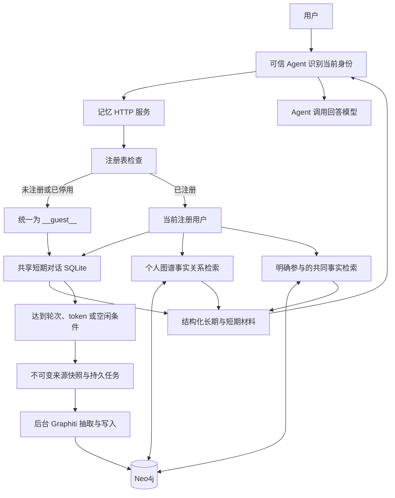

# Bumi_Mem

> 本次更新（2026-10-21）：补齐注册用户长期隔离、逐文件改动说明和可复现示例；明确当前默认检索、启动步骤和权限边界。

面向陪伴机器人与对话 Agent 的记忆服务。**SQLite 保存短期对话和后台任务，Graphiti + Neo4j 保存长期事实与知识图谱，Agent 调用 HTTP 接口获取记忆材料并自行生成回答。**

当前为 Graphiti 实验版，包版本 `0.6.0`。默认开启注册用户长期记忆隔离，使用本地 Qwen3-Embedding-0.6B 和无模型 RRF 排序，不加载 BGE。旧 Mem0 实现保留用于历史对照，不作为当前 HTTP 主链路。

[快速启动](#快速启动) · [架构与流程](#架构与流程) · [用户隔离规则](#用户隔离规则) · [Agent 接入](#agent-接入) · [网页入口](#网页入口) · [验证结果](#验证结果) · [逐文件改动与示例](docs/用户隔离改动说明与示例-20261021.md)

## 当前功能

| 功能 | 当前行为 |
|---|---|
| 短期对话 | 按 Agent 共享，SQLite 持久化；用户切换不清空近期原话 |
| 个人长期记忆 | 只向当前注册用户提供其个人事实 |
| 共同记忆 | 明确涉及双方的关系或共同经历可被参与者读取，标注原发言者 |
| 陌生人 | 所有未注册/已停用身份映射为 `__guest__`，只使用共享短期记忆 |
| 后台整理 | 10 个完成轮次、约 8000 tokens 或 Agent 连续空闲 120 秒触发 |
| 文字控制 | 支持“记住”“别记上一句”和候选确认删除，不增加意图识别 LLM 调用 |
| 记忆管理 | 管理员网页支持事实编辑、逻辑删除、恢复及 3D 图谱 |
| 共同事实管理 | 支持对我隐藏、异议、原发言者修改/撤回及管理员操作 |
| 恢复与审计 | 持久化任务、来源、版本与回执；不确定写入不自动盲目重放 |

**本次实现的是长期检索隔离，不是全对话隐私隔离。** 短期原话和已说出的助手回复仍共享，可能包含其他人的个人信息。注册表不替代登录认证；当前由可信 Agent 负责识别用户，服务端核验其注册状态。

## 架构与流程



| 数据 | 保存位置 | 说明 |
|---|---|---|
| 原话、注册表、轮次、队列、引用与审计 | `BUMI_DATA_DIR/bumi_memory.sqlite3` | 注册表按 Agent 管理；短期对话仍共享 |
| 个人图谱 | Neo4j | 按 `user_id + agent_id` 派生独立分组 |
| 共同事实与实体身份绑定 | Neo4j | `BumiSharedFact`、`BumiRegisteredIdentity`；地点实体不绑定账号 |
| 管理员修订与来源屏蔽 | Neo4j | 编辑/删除状态、旧来源阻断、版本及回执 |
| 图写入日志、社区任务水位 | `BUMI_DATA_DIR/graphiti/` | 用于核对完成状态和不确定写入 |
| 模型与真实凭证 | 部署环境的外部目录 | 不纳入 Git |

当前 Graphiti 主链路不先生成旧 L2 会话摘要；旧 L2/Mem0 代码只用于历史兼容与实验对照。

### 写入

- 每轮先补存上一轮已确认输出的助手回复，再保存当前用户原话。
- 默认达到 **10 个完成轮次 / 约 8000 tokens / 连续空闲 120 秒**之一后提交后台整理；模型实际处理时间另算。
- 空闲按 Agent 的服务器收信时间计时，所有用户共用该 Agent 的活动计时，抽取来源仍按所有者分开。
- 独立快照不会关闭等待迟到回复的原会话，已经提交的来源不重复进入后续批次。
- 未注册用户不生成个人或共同长期记忆；停用/未注册所有者的旧排队抽取会明确失败，不误报已保存。
- “排队成功”不代表“保存成功”。写入结果不确定时保留核查入口，不承诺跨 SQLite/Neo4j 的端到端 exactly-once。

### 检索

**默认隔离模式：个人事实关系 + 有权限的共同事实。** 两类检索复用一次本地查询向量；个人关系使用 Graphiti 的关键词、向量、图遍历与 RRF，普通个人关系和共同事实各最多 10 条。管理员修订可能补充条目，最终仍受预算约束。

- 不返回未完成权限拆分的实体摘要、整段 episode 原文和社区摘要。
- 不沿朋友、学校或图书馆节点继续扩大访问权限。
- 长期引用默认预算 **24000 字符**，不是 token 数；保留完整条目，不从事实中间截断。
- 不加载 BGE，不调用额外 LLM 做重排、问题改写或共享意图判断。
- 底层完整 Graphiti 配方仍保留事实、实体、episode、community 四类检索，用于旧模式和对照；它不是当前隔离模式的返回范围。

## 用户隔离规则

注册身份与图谱实体分开：小王可绑定 `user1`，小李可绑定 `user2`；图书馆是地点实体，没有注册用户 ID。只通过明确 ID、唯一名称或已登记别名关联人物，不让 LLM 创建账号或猜测重名。

| 原话/场景 | 长期行为 |
|---|---|
| user2：“昨天我去了博物馆。” | user2 私有，不因 user1 是朋友而开放 |
| user2：“我和小王是朋友。” | 双方可读取，注明来源 user2、单方陈述 |
| user2：“我和小王昨天一起去了图书馆。” | 共同经历明确记录参与者和来源 |
| user2：“我和小王在同一所大学上学。” | 可记录这条明确共同关系 |
| 两人分别说在同一大学读书 | 不自动推导同校关系 |
| user2：“小王已经退学了。” | 留在 user2 的私人陈述，不覆盖 user1 的个人事实 |
| “我们去了图书馆”或人物重名 | 不猜参与者，不自动共享 |
| 陌生人：“我是小王的朋友。” | 仅保留共享短期，不建立长期关系 |

共同事实暂不要求双方确认，保留单方来源；这不代表事实已被双方证实。原发言者可修改或撤回，其他参与者可隐藏或提出异议。修改内容必须仍是同一组参与者的明确共同陈述。

修改/撤回会屏蔽原始来源及其关联 Graphiti 批次，**可能影响同批次其他事实**，需要确认范围。原始聊天、备份和审计保留，另一位参与者的独立证据不随之消失。

第一版只识别部分明确双人句式；复杂多人表达、反向语序、指代和混合句可能不建立共享记忆。历史图谱保持原所有者私有，不自动转换为共享事实。

## 快速启动

### 1. 安装与准备

需要 Python 3.10+、Neo4j、本地 embedding 模型和 OpenAI-compatible 记忆模型 API。当前环境验证使用 Neo4j 5.26。

```bash
git clone https://github.com/Noetix-AI/Bumi_Mem.git
cd Bumi_Mem
python3 -m venv .venv
source .venv/bin/activate
python -m pip install -e '.[server,runtime,test]'
```

GPU 环境需安装匹配的 PyTorch。服务从本地路径加载 Qwen3-Embedding-0.6B，向量维度为 1024，不自动下载模型。Graphiti 源码固定到 `v0.31.0` 标签，该标签的包 metadata 为 `0.32.0`。当前服务无需初始化历史 Mem0 子模块。

### 2. 配置外部凭证

```bash
mkdir -p ../bumi-runtime/secrets
cp configs/graphiti.env.example ../bumi-runtime/secrets/graphiti.env
chmod 600 ../bumi-runtime/secrets/graphiti.env
export BUMI_SERVICE_ENV_FILE="$(cd ../bumi-runtime/secrets && pwd)/graphiti.env"
```

编辑该外部文件，替换路径与占位凭证：

| 配置 | 用途 |
|---|---|
| `BUMI_DATA_DIR` | 当前实例独立的 SQLite 与运行目录 |
| `BUMI_PYTHON` | 已安装本项目的 Python 绝对路径 |
| `BUMI_NEO4J_URI / USER / PASSWORD` | Neo4j 连接 |
| `BUMI_EMBED_MODEL_PATH / DEVICE` | 本地 embedding 路径，设备为 auto/cpu/cuda |
| `BUMI_MEMORY_API_KEY / BASE_URL / MODEL` | 后台抽取和社区摘要使用的模型 |
| `BUMI_SERVICE_API_KEY` | 至少 32 字符的服务密钥，供可信 Agent/管理员使用 |
| `BUMI_AGENT_ID` | 当前实例固定 Agent 身份 |
| `BUMI_REGISTERED_ISOLATION` | 默认 on，先注册用户再使用个人长期检索 |
| `BUMI_HOST / PORT` | 建议绑定 127.0.0.1，样例端口 18099 |

旧 `BUMI_RERANKER_MODEL_PATH` 和 `BUMI_RERANKER_FP16` 保留兼容，当前 RRF 不加载 BGE。

### 3. 预检、启动与注册

```bash
set -a
source "$BUMI_SERVICE_ENV_FILE"
set +a
python -m bumi_mem.service_probe --skip-llm
bash scripts/run_memory_service.sh
```

启动会加载 embedding、准备图索引和约束。访问 `/health/ready` 检查就绪；就绪不代表记忆质量已经验收。同一 SQLite 目录只运行一个服务进程。

**新实例注册表为空，所有请求身份先按陌生人处理。** 在另一终端加载外部配置后注册：

```bash
curl -X PUT "http://127.0.0.1:${BUMI_PORT:-18099}/v2/admin/users" \
  -H "Authorization: Bearer $BUMI_SERVICE_API_KEY" \
  -H 'Content-Type: application/json' \
  -d '{"user_id":"user1","display_name":"小王","aliases":["王同学"],"active":true}'
```

再注册 `user2 / 小李` 即可测试共同记忆。现有历史用户也需按原 ID 显式注册。

SQLite 自动升级到 **schema 11**，旧程序不能直接降级读取新库；实例启用隔离后会持久保存策略，不因仅将环境开关设为 off 而清除。部署细节见 [Graphiti 说明](docs/deployment/GRAPHITI.md) 和 [隔离说明](docs/registered_isolation.md)。

## Agent 接入

每轮调用 `POST /v1/memory/context`。服务固定 Agent ID，请求不传 `agent_id`。

```json
{
  "turn_id": "conversation-001:turn-001",
  "user_id": "user1",
  "query": "小李和我是什么关系？",
  "previous_ai_reply": null
}
```

响应示意，内容不是固定模型输出：

```json
{
  "turn_id": "conversation-001:turn-001",
  "current_user": "user1",
  "long_term_memory": [
    {
      "user_id": "user1",
      "content": "[单方陈述，来源用户 user2] 我和小王是朋友",
      "time": ["2026-10-21T10:00:00+08:00"]
    }
  ],
  "short_term_memory": [
    {
      "role": "user",
      "speaker_id": "user1",
      "content": "小李和我是什么关系？",
      "time": "2026-10-21T10:05:00+08:00"
    }
  ]
}
```

- 四个顶层字段保持兼容；未注册 ID 的 `current_user` 为 `__guest__`，长期数组为空。
- 第一轮不传上一轮回复；后续只提交 Agent 已确认输出的回复。使用新 `turn_id`、`query: null` 可补存最后一条回复，不等于强制整理尾批。
- 网络重试保留相同 `turn_id` 与请求内容；下一轮使用新 ID。
- 可选 `query_occurred_at`、`previous_reply_occurred_at` 保留原始事件时间，不影响按服务器收信时间计算空闲。
- 用户切换清除前一位的长期引用与预取缓存，保留共享短期。注册/权限变更可能使旧缓存请求返回冲突，此时重新发起当前轮次。

接口细节见 [Agent 协议](docs/agent_api/README.md)。

## 网页入口

路径属于同一个 FastAPI 应用；下列端口是各独立启动脚本的默认值，不是路径绑定的固定端口。

| 页面 | 用途 | 独立脚本默认端口 |
|---|---|---:|
| `/isolation` | 注册、切换身份、文本测试、共同事实管理 | 18111 |
| `/admin` | 管理员事实编辑、逻辑删除/恢复、3D 图谱 | 18109 |
| `/memory-control` | 独立控制密钥的“记住/忘记”测试 | 18110 |

隔离测试实例使用独立目录：

```bash
export BUMI_ISOLATION_DATA_DIR="$(pwd)/../bumi-runtime/isolation-data"
bash scripts/run_memory_isolation.sh
```

服务器运行时，使用 VS Code 端口转发或 SSH 隧道，再打开 `http://localhost:18111/isolation`。页面中的服务密钥只用于可信 Agent/管理员测试，不交给终端用户。

文字控制使用不同于服务密钥的 `BUMI_CONTROL_API_KEY`，固定绑定 `BUMI_CONTROL_USER_ID`，该用户也必须注册。保存返回 queued，确认写入后才返回 applied；删除需选择候选并确认来源范围。详见 [文字控制](docs/memory_control.md)、[管理员网页](docs/admin_memory.md)。

## 主要接口

| 方法与路径 | 用途 |
|---|---|
| `POST /v1/memory/context` | 当前用户的长期材料与共享短期对话 |
| `GET/PUT /v2/admin/users` | 注册表管理 |
| `GET /v2/memory/shared?user_id=…` | 当前身份可管理的共同陈述 |
| `PATCH /v2/memory/shared/{id}` | 隐藏、恢复显示、异议、原发言者修改/撤回 |
| `PATCH /v2/admin/shared/{id}` | 管理员修改/撤回共同陈述 |
| `POST /v2/memory/context` | 独立密钥的文字控制协议 |
| `GET /v2/memory/operations/{id}` | 核对文字控制操作回执 |
| `GET /health/ready` | 服务就绪状态 |

普通 Agent 和管理员接口目前沿用同一服务密钥，尚未建立终端用户登录、多角色密钥分离和多实例缓存全局撤销。具体请求字段、来源范围与版本规则见专题说明。

## 验证结果

- **2026-10-21 回归：689 passed，8 skipped。** 最终注册、文字控制及 Graphiti 相关回归 80 项通过。
- 真实 Neo4j 控制和隔离测试另行启用，2 项通过；默认跳过不表示未单独验证。
- 真实 LLM + embedding + Graphiti + Neo4j 链路验证：user2 说“我和小王是朋友。昨天我去了博物馆。”，user1 长期结果只有带来源的关系，user2 仍能召回自己的行程；陌生人长期为空，短期共享。隐藏、异议、撤回和重启恢复也已验证。

```bash
python -m pytest -q tests
# 显式配置 Neo4j 环境变量后执行独立临时作用域测试：
BUMI_RUN_NEO4J_ISOLATION_TEST=1 BUMI_RUN_NEO4J_CONTROL_TEST=1 \
  python -m pytest -q tests/test_isolation_graph_integration.py tests/test_control_graph_integration.py
```

**历史性能对照，不等同于本次隔离版本验收：** 2026-10-20 在同一图谱、62 题、24000 字符预算下，BGE/RRF 自动判对均为 59/62；检索中位数由 1759ms 降至 267ms，RRF P95 约 282ms。单次 LLM 评分不证明统计等效，也未达到 100ms。隔离改版后尚未重跑整套 62 题准确率。

上述功能测试不替代通用质量、并发压测或完整安全审计。原始数据库、对话、测评记录与凭证保留在服务器私有目录，不上传仓库。

## 代码与文档导航

| 路径 | 职责 |
|---|---|
| `src/bumi_mem/registry.py` | 注册表、陌生人映射、身份切换及缓存失效 |
| `src/bumi_mem/shared_facts.py` | 明确共同关系/经历的保守规则 |
| `src/bumi_mem/isolation_graph.py` | 人物绑定、共同事实查询及修改 |
| `src/bumi_mem/isolation_api.py`、`isolation.html` | 注册/共同事实 API 与文字测试页 |
| `src/bumi_mem/engine.py`、`agent_engine.py` | 对话入口、检索与上下文编排 |
| `src/bumi_mem/graphiti_memory.py` | 图谱写入、检索和完成日志 |
| `src/bumi_mem/consolidator.py`、`worker.py` | 持久后台整理与来源处理 |
| `src/bumi_mem/memory_control.py` | 文字控制、候选与回执 |
| `src/bumi_mem/admin_api.py`、`admin_memory.py` | 管理员事实与图谱操作 |
| `scripts/`、`configs/` | 启动脚本和无真实凭证的配置样例 |

- [本次改动、逐文件清单与具体示例](docs/用户隔离改动说明与示例-20261021.md)
- [注册用户隔离：配置、协议与限制](docs/registered_isolation.md)
- [注册用户隔离验证报告](docs/registered_isolation_verification.md)
- [文字记忆控制](docs/memory_control.md)及[验证记录](docs/memory_control_verification.md)
- [管理员网页](docs/admin_memory.md)
- [Graphiti 部署与验收](docs/deployment/GRAPHITI.md)
- [旧 Mem0 说明归档](docs/history/README-mem0.md)，不作为当前入口

代码更新遵循 [AGENTS.md](AGENTS.md)：**通过分支和 PR 提交，不直接推送 main**。
