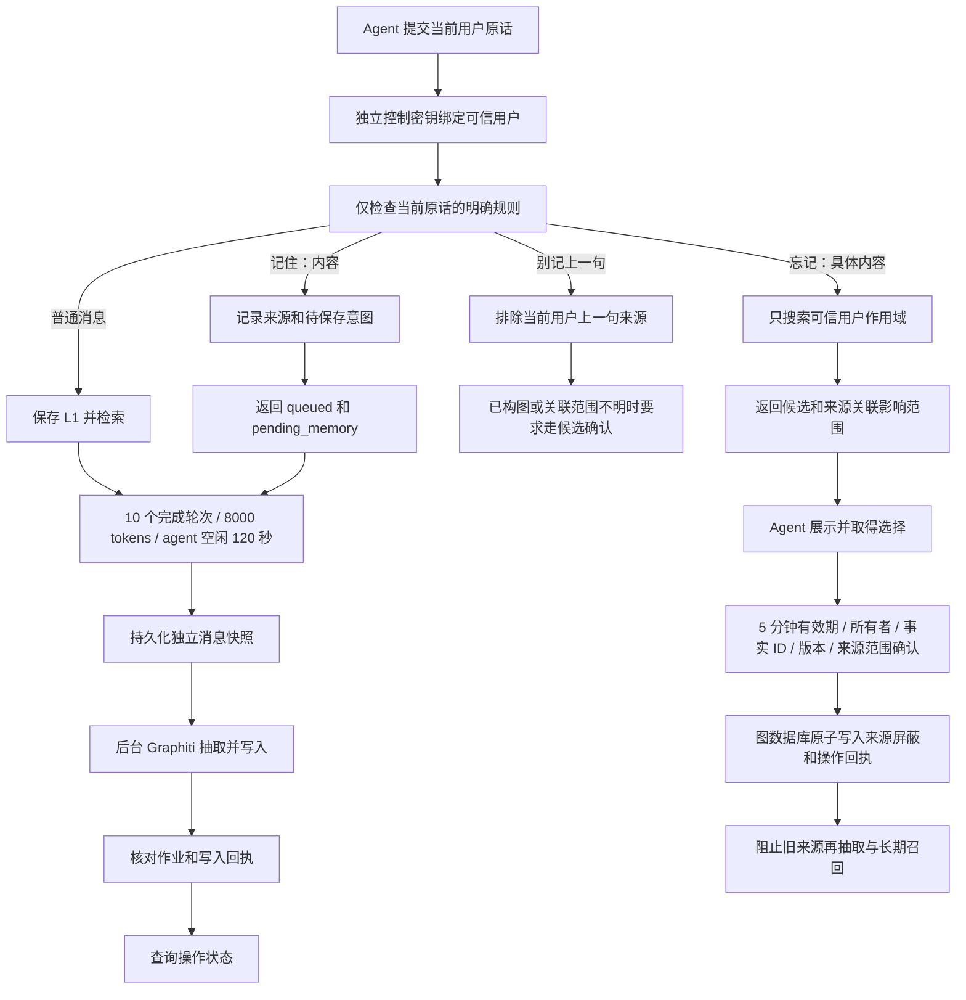

# 文字记忆控制试用版

> 本次改动（2026-10-21）：补充当前 schema 11 和控制用户必须先注册的前置条件；保留文字控制初版协议说明。

服务新增 `/v2/memory/context` 和 `/memory-control` 文字测试页。Agent 继续负责与用户交互：服务返回排队回执、候选和待确认操作，Agent 展示后把选择传回来。识别指令使用当前用户消息的保守规则，不新增意图识别 LLM 调用。

旧 `/v1/memory/context` 的四字段返回协议保持原样；新功能需要明确使用 v2。

## 行为与流程



- `记住：我喜欢喝无糖拿铁。`：记录原始消息 ID，返回 `queued`。同次及后续 v2 请求可从 `pending_memory` 取到原文，明确标注 `persisted: false`。后台写入确认后才返回 `applied`。
- `别记上一句`：只定位当前可信用户上一条原话。未构图时立即排除该来源；如果已构图或已进入关联多来源的批次，要求通过“忘记：内容”选择并确认，避免默默影响其他事实。
- `忘记：无糖拿铁`：最多返回 10 条包含查询文字的事实候选。候选不是已经删除的记忆，需要带回 ID、版本和来源范围确认。
- 引用别人说的话、检索到的文本、上一轮助手回复都不会进入指令解析器。当前规则要求冒号、逗号或空格分隔；不使用模型猜测隐含删除意图。
- 删除保留聊天原文、备份和审计记录。它让旧来源停止进入后续长期记忆召回和抽取。新用户原话拥有新的来源 ID，可以重新形成同一主题的记忆。
- Graphiti 的来源粒度通常是整个 episode 批次。确认页面展示来源数量和关联事实数量，可能影响同批次的其他事实；派生实体摘要、episode 和社区摘要会保守地停止用于该作用域的长期召回。不会宣称进行了逐句精确物理删除。
- 旧数据若缺少可靠来源账本，候选会显示 `can_delete: false`。同一后端已有完整成功写入日志的批次可自动补齐来源账本；不从自然语言正文猜测消息身份。

## 120 秒空闲整理

计时按 **agent**，由收到用户消息的服务器时间重置，和消息携带的历史事件时间无关。所有用户共用 agent 的活动计时，各用户的抽取快照仍分开。

后台每约 1 秒扫描一次；持续空闲达到 120 秒就为尚未提交的已保存证据建快照。保留 10 完成轮次和 8000 tokens 的更早触发条件。模型实际处理耗时另算。

独立快照不会关闭原活动会话，所以未完成轮次的助手回复可以稍后结算。来源领取记录持久化，已经快照的消息不会被后续批次重复提交；重启后会处理已经到期的内容。仍然遵守原有“不确定写入不能自动盲目重放”的限制。

## 本机/SSH 文字测试

使用独立 SQLite 目录和 agent ID，避免测试操作影响其他记忆。

准备服务器上的私有配置文件（不要加入 Git）：

```bash
# /path/outside/repository/control.env
BUMI_CONTROL_API_KEY=替换为独立随机密钥且至少32字符
BUMI_CONTROL_USER_ID=memory_control_test
BUMI_CONTROL_DATA_DIR=/path/to/private/control-data
BUMI_CONTROL_AGENT_ID=bumi_control_pilot
BUMI_CONTROL_PORT=18110
# BUMI_CONTROL_GPU=4
```

密钥必须与 `BUMI_SERVICE_API_KEY` 不同。该密钥只可操作服务端固定绑定的用户，不能指定其他用户或 agent；也不能调用管理员接口。已有管理员密钥不允许调用 v2 控制接口。

```bash
cd /data1/sunzhixing/Bumi_mem_2
BUMI_SERVICE_ENV_FILE=/data1/sunzhixing/Bumi_mem_2_test/configs/local.env \
BUMI_CONTROL_ENV_FILE=/data1/sunzhixing/Bumi_mem_2_test/configs/control.env \
bash scripts/run_memory_control.sh
```

如果终端存在无法使用的 SOCKS 代理，先清理该终端的 `ALL_PROXY/all_proxy/HTTP_PROXY/http_proxy/HTTPS_PROXY/https_proxy`，再启动。页面通过 SSH/VS Code 转发服务器 **18110** 端口后打开：

`http://localhost:18110/memory-control`

填入配置文件中的控制密钥和绑定用户。输入测试文字并发送；可以刷新最后操作状态。确认删除按钮展示关联范围，并要求确认。网络失败使用“重试上次请求”，不要换请求 ID 盲目重发。页面不会保存密钥到浏览器存储，不加载外部 CDN。

当前服务器已准备私有 `configs/control.env`（权限 0600），绑定用户 `memory_control_test`。不要把该文件的真实密钥复制进文档或版本库。

## Agent 协议

```json
{
  "turn_id": "unique-client-request-id",
  "user_id": "memory_control_test",
  "query": "记住：我喜欢喝无糖拿铁。",
  "previous_ai_reply": null
}
```

`POST /v2/memory/context` 使用 `Authorization: Bearer <control-key>`。保留四个上下文字段，新增 `pending_memory`，有控制动作时新增 `memory_control`。`query_occurred_at`、`previous_reply_occurred_at` 仍可传入。

`GET /v2/memory/operations/{operation_id}` 查询自己的操作状态。

选择删除时发送独立的新 `turn_id`，并让 `query` 为 `null`：

```json
{
  "turn_id": "unique-selection-request-id",
  "user_id": "memory_control_test",
  "query": null,
  "memory_control_reply": {
    "operation_id": "原候选操作ID",
    "memory_id": "候选事实ID",
    "version": 0,
    "confirm_source_scope": true
  }
}
```

`queued` 表示待处理；`needs_selection` 表示等待用户选择；`applied` 表示已经确认生效；`failed` 表示失败；`uncertain` 表示外部写入可能生效但尚未核对。删除在写入前持久化意图，并在 Neo4j 同一事务中记录来源屏蔽和回执。响应丢失后可以按原操作 ID 核对回执；不会通过重新调用 LLM 猜测结果。

候选绑定用户和 agent，5 分钟后不能新执行删除。用户切换会让此前等待选择的操作失效。删除时再次核对版本、episode 集合和来源指纹；成功操作重复确认只返回原结果。

## 安全范围与限制

这是固定可信用户的文字试用协议，还不是完整的账号、家庭共享和权限系统。v2 返回会过滤其他用户的长期材料和短期原话，但历史共享助手输出本身可能包含先前现场内容，不能据此承诺完整的跨用户隐私隔离。

同一服务的引用缓存会在删除后失效，图数据库来源屏蔽供后续实时检索使用；另一独立 SQLite 服务中已经缓存的旧响应没有全局即时撤销协议。部署多实例前，需要补齐全局缓存撤销和鉴权。这版应通过 SSH 转发在本地测试。

## 验证

```bash
python -m pytest -q tests
# 在已配置 Neo4j 环境变量的终端，执行不调用模型的独立图数据库测试：
BUMI_RUN_NEO4J_CONTROL_TEST=1 python -m pytest -q tests/test_control_graph_integration.py
```

2026-10-20 完整文字链路已使用真实 Graphiti、embedding、LLM 和 Neo4j 验证：待保存回执 → 实际等待 120 秒空闲 → 写入完成 → 召回 → 选择并确认删除 → 后续长期召回为空。保存到完成约 124.7 秒，包含空闲等待，不代表构图本身耗时。

服务器验证原始结果：`/data1/sunzhixing/Bumi_mem_2_test/runtime/memory_control/e2e.json`。

完整验证记录见 [文字记忆控制验证记录](memory_control_verification.md)。文字控制初版引入 schema 10；当前注册隔离版本已升级到 schema 11。旧程序不能直接降级读取迁移后的数据库，控制密钥绑定的用户也需要先注册，见 [注册隔离说明](registered_isolation.md)。
