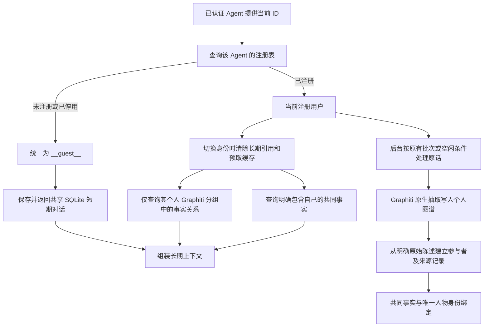

# 注册用户长期记忆隔离（第一版）

> 本次改动（2026-10-21）：记录注册与实体绑定、共同事实权限、陌生人行为、管理接口和部署限制。

## 已确认的边界

长期记忆以可信 Agent 提供的当前注册用户为读取主体；短期对话继续按 Agent 共享、写入 SQLite。原始助手回复也继续共享。因此这是**长期检索访问控制**，不是完整的对话隐私隔离。

| 情况 | 第一版行为 |
|---|---|
| 当前注册用户的历史个人图谱 | 仅该用户读取具体事实；不自动迁移为共享事实 |
| 明确表达“我和小王是朋友” | 形成带来源的共同关系，双方可读取，注明单方陈述 |
| 明确表达“我和小王昨天一起去了图书馆” | 形成有明确参与者和来源的共同经历 |
| “我和小王在同一所大学上学” | 可形成明确共同关系 |
| 两人各自说在同一大学、同一地点 | 不自动推导共同关系 |
| “小王昨天去了博物馆” | 仅属于发言者的私人陈述，不开放为小王的共同事实，不覆盖小王自己的资料 |
| “我们昨天去了图书馆”或人物重名 | 不猜测参与者，不建立共享关系 |
| 未注册或已停用 ID | 在持久化前映射为 `__guest__`，只返回共享短期内容，不生成/操作个人长期记忆 |
| 陌生人说“我是 user1 的朋友” | 不为注册用户建立长期关系 |

普通人物、学校、图书馆仍是图谱实体。注册账号独立存于 SQLite `registered_users`，注册人物通过 `BumiRegisteredIdentity` 与图谱实体绑定。地点没有注册账号；相邻节点只提供身份定位，不开放完整人物摘要。身份绑定依赖注册 ID、唯一名称/已登记别名，不由 LLM 创建账号或猜测同名人物。

## 实现流程



隔离模式下，个人图谱使用 RRF 的事实关系检索；停止返回实体摘要、整批 episode 和社区摘要。共同事实存为独立 `BumiSharedFact`，包含原发言者、参与者、来源消息 ID、时间、版本和删除状态；只在**当前用户明确属于参与者**时返回，不沿朋友或大学节点继续扩展访问权限。

共同事实用本地向量排序，普通个人关系与共同事实各最多 10 条；管理员修订仍可能补充条目，最终受上下文预算约束。两类检索复用一次查询向量，不新增 LLM 意图调用。共同材料返回当前接收者作用域，同时在内容和元数据中明确原发言者，避免误当成接收者的亲口陈述。

### 第一版识别范围

共同关系使用保守的原话规则，支持“我和/我跟/我与 + 唯一注册名称、别名或 ID + 是朋友/同学/大学同学/同事/室友/兄弟/姐妹”等，以及明确同校表达、明确双人一起去过某地的表达。

这是可用原型，不是任意自然语言关系的通用抽取器：复杂多人句、反向语序、指代、省略、引语、疑问、假设和歧义表达不会自动共享，继续保存在原发言者个人图谱。部分含逗号的混合陈述会被保守跳过。注册之前的旧批次不会自动补建共享记录。

## 注册与启动

Graphiti HTTP 服务默认 `BUMI_REGISTERED_ISOLATION=on`，首次启动注册表为空时所有来访 ID 都按陌生人处理。必须先注册需要使用个人长期记忆的用户。当前实验 CLI 保留原适配行为；不要用它绕过 HTTP 服务作为用户权限入口。

SQLite 自动升级到 **schema 11**。一旦该实例启用隔离，SQLite 会持久保存策略；仅修改环境变量为 off 不会清除已有策略。旧程序不能直接降级读取新库。现有历史数据不会被改写或自动共享。

建议先启动独立实例：

```bash
cd /data1/sunzhixing/Bumi_mem_2
BUMI_SERVICE_ENV_FILE=/data1/sunzhixing/Bumi_mem_2_test/configs/local.env \
BUMI_ISOLATION_DATA_DIR=/data1/sunzhixing/Bumi_mem_2_test/runtime/registered_isolation/data \
BUMI_ISOLATION_GPU=4 \
bash scripts/run_memory_isolation.sh
```

默认 Agent 为 `bumi_isolation_console`、端口 **18111**。服务器通过 VS Code / SSH 转发后访问：

`http://localhost:18111/isolation`

页面提供注册表、身份切换、文本交互、共同事实列表以及隐藏/异议/修改/撤回。服务密钥仅保存在页面内存，页面通过同源 API 访问，不引入外部 CDN。当前页面是**可信 Agent / 管理员测试台**，不要向普通用户提供服务密钥。

当前服务器的验证实例已注册 `user1 → 小王`、`user2 → 小李`。真实写入验收时临时将 `BUMI_ISOLATION_EXTRACTION_TURNS=1`；正常使用默认 10 轮，其他触发条件保持不变。

## API

所有以下接口均使用已有 `Authorization: Bearer <BUMI_SERVICE_API_KEY>`。这里信任 Agent 已识别用户；注册检查不等于用户登录认证。浏览器最终用户不能任意指定他人 ID。

### 注册表（管理员操作）

- `GET /v2/admin/users`：列出当前 Agent 的注册信息。
- `PUT /v2/admin/users`：注册、更新或停用。ID 稳定，不提供删除后复用账号 ID 的接口。

```json
{
  "user_id": "user1",
  "display_name": "小王",
  "aliases": ["王同学"],
  "active": true
}
```

同名允许存在，但不能凭该重名名称建立身份关联；明确注册 ID 仍需唯一。注册、停用和名称更新会使本实例旧长期上下文与预取缓存失效。

### 普通对话

继续使用 `POST /v1/memory/context`，四字段响应保持不变。注册者返回自己的事实及明确共同事实；未知 ID 返回 `current_user: "__guest__"`；对该陌生身份，`long_term_memory` 始终为空，`short_term_memory` 保留共享现场。

原 Agent prepare/prefetch 协议也会检查注册状态；未注册 matched profile 不会原样持久化为记忆身份。v2 文字控制仍使用独立控制密钥，但固定绑定的用户也必须注册。陌生人无法用“记住/忘记”操作长期记忆。

切换用户不会清空 L1，但会撤销上一位用户的长期引用和预取候选。隔离模式不复用未经重新鉴权的预取材料。策略变更后，旧请求可能返回上下文过期冲突，需要重新发起当前轮次；不返回旧私人缓存。

### 共同事实

`GET /v2/memory/shared?user_id=user1` 返回最多 100 条当前身份可管理的共同陈述，包含事实 ID、版本、原发言者、参与者和隐藏/异议状态。隐藏内容仍在该列表中，方便取消隐藏，但不会进入该用户的共享长期检索结果。

`PATCH /v2/memory/shared/{id}`：

```json
{
  "user_id": "user1",
  "version": 0,
  "action": "hide"
}
```

- `hide` / `unhide`：对自己隐藏/恢复共同陈述，不替其他人删除，也不删除自己的独立个人证据。
- `dispute`：记录异议，后续共同召回注明存在异议，不改写原始证据。
- `edit` / `withdraw`：仅原发言者可执行，必须带 `confirm_source_scope: true`；修改需另传 `content`。普通用户修改时会重新验证内容仍是同一组参与者的明确共同陈述，不允许修改参与者列表或把关系改写成他人的个人资料。
- `PATCH /v2/admin/shared/{id}`：管理员可修改或撤回，审计执行者标记为管理员；同样需要版本和来源范围确认。

修改/撤回会屏蔽原始来源及其关联 Graphiti 批次，**可能同时抑制该批次的其他私人事实**；不是保证只删除单条关系。修改后的共同内容使用新修订证据，旧原话不会重新覆盖它。来源、修改前后内容和操作审计保留。另一位参与者提供的独立陈述不随原发言者撤回而消失。聊天原文和备份仍保留。

## 部署限制

- 注册表和上下文撤销目前属于单 SQLite 实例；同一 Agent 不应使用多套独立 SQLite 注册表并发服务。
- 仍使用现有服务密钥保护可信 Agent 和管理员接口，尚无终端用户登录、多角色管理员密钥分离或声纹认证实现。
- 共享短期原话和已说出的助手内容仍可包含其他人的私人信息。此版本不承诺全对话隐私隔离。
- 共享事实识别规则刻意保守；宁可少共享，不因模型猜测暴露他人资料。
- 历史用户必须由管理员显式注册原 ID 后，才能恢复其个人长期查询；不自动注册任意来访 ID。

## 验证

```bash
python -m pytest -q tests
# 显式配置 Neo4j 环境变量后，启用独立临时作用域测试：
BUMI_RUN_NEO4J_ISOLATION_TEST=1 python -m pytest -q tests/test_isolation_graph_integration.py
```

真实 LLM + embedding + Graphiti + Neo4j 链路结果保存在服务器：

`/data1/sunzhixing/Bumi_mem_2_test/runtime/registered_isolation/e2e.json`

用“我和小王是朋友。昨天我去了博物馆。”验证：user1 仅获得带来源的朋友关系，user2 能召回自己的博物馆行程；陌生人长期结果为空但保留共享短期。还验证了非原发言者不能撤回、对我隐藏、取消隐藏、异议、原发言者撤回及未知身份不原样写入 SQLite。

完整验证记录见 [注册用户隔离验证报告](registered_isolation_verification.md)。
