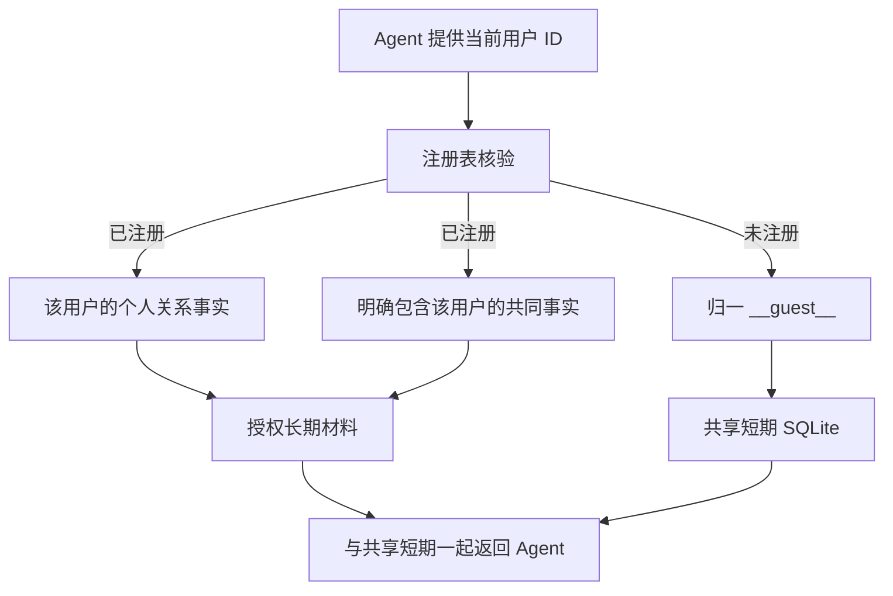

# 用户隔离改动说明与示例（2026-10-21）

> 本次改动：集中记录用户隔离实现、逐文件变更、使用例子、验证结果与交付边界；本文件同时保存在本地仓库并随代码提交。

## 先说结论

这版把“长期记忆谁能读”控制起来：**注册用户读自己的事实和明确涉及自己的共同陈述；陌生人只用共享短期对话，不生成长期记忆。** 短期仍按 Agent 共享并写入 SQLite，所以它不是全对话隐私隔离。

例如，小李说：“我和小王是朋友。昨天我去了博物馆。”小王可以从长期记忆中读到带来源的朋友关系，但不能因此读取小李的博物馆行程。若该原话还在共享短期窗口中，小王仍可能在短期上下文看到它——这是已确认保留的现场共享行为。

实现基线为 PR #45 的 `feat/memory-control-admin-rrf` 分支。本次隔离功能提交为 `407e279`，对应 PR #46；后续文档提交补齐逐文件标注、README 和本说明。它不包含 kvsleep、KV 压缩或 Stage3C 实验内容。

## 一、这次改了什么

### 1. 将注册身份和图谱实体分开

- 注册表保存 `user_id`、显示名称、别名、启用状态和版本，按 Agent 管理。
- 图谱里仍有人物、地点、学校等实体；只有注册人物可以绑定账号 ID，图书馆不是账号。
- 身份来自可信 Agent；只有唯一名称、已登记别名或明确注册 ID 才能绑定，不让 LLM 创建账号或猜同名人物。
- 未注册或已停用的请求 ID 在身份字段持久化前统一为 `__guest__`。对话正文仍原样保存，不承诺清除正文中用户自己说出的名字或 ID。

### 2. 个人图谱保留，共同事实单独记录

原有个人图谱继续按 `user_id + agent_id` 分组，历史数据不自动转换成共享内容。新增的共同事实记录原发言者、明确参与者、原始消息、时间、版本、删除及反馈状态。

第一版允许单方陈述参与共享，因此返回时注明“来源用户 user2”，不宣称双方已确认。共同事实只是具体一条陈述的开放，不代表朋友之间互相开放全部个人图谱。

### 3. 收紧检索材料



隔离模式只返回关系事实与共同事实，暂不向回答端提供人物完整摘要、episode 整段原文或社区摘要。不会沿朋友或大学继续扩展权限，也不根据两个人分别去过同一地点、就读同一学校而推导共同关系。

个人与共同检索复用本地查询向量，没有增加额外的 LLM 意图判断。原有 RRF 和不加载 BGE 的行为保留。

### 4. 共同事实有自己的管理规则

| 操作 | 谁能操作 | 效果 |
|---|---|---|
| 隐藏 / 取消隐藏 | 参与者本人 | 只影响该共同陈述对自己的检索可见性 |
| 异议 | 参与者本人 | 保留原始陈述，记录反馈，召回时注明异议 |
| 修改 | 原发言者或管理员 | 核对版本及来源范围；普通用户不能更换参与者或改成他人的个人资料 |
| 撤回 | 原发言者或管理员 | 屏蔽旧来源并停止相关共同陈述的召回 |

修改/撤回会影响原始来源及其关联 Graphiti 批次，可能抑制同批次其他事实，接口要求 `confirm_source_scope: true`。保留聊天和审计；另一方的独立来源不会随之消失。新的独立原话可以重新支持事实，旧来源重放不会自动复活撤回内容。

### 5. 用户切换时清理长期缓存

切换当前用户会撤销上一位的长期引用并清理预取缓存；注册状态或权限变更会使旧上下文失效。短期原话与已经说出的助手回复仍保留共享。旧请求可能因上下文过期返回冲突，需要重新发起当前轮次，不把旧私人缓存交给新用户。

## 二、逐文件修改清单

每个本次新增/修改文件都有文件内日期标注，下面逐项说明。Python、Shell、HTML 和 TOML 使用注释；Markdown 在开头使用更新说明。本轮补充标注不改变业务执行逻辑。

| 文件 | 类型 | 具体修改 |
|---|---|---|
| [README.md](../README.md) | 修改 | 重写当前版本入口，统一隔离默认行为、架构图、安装注册步骤、接口和验证边界。 |
| [configs/graphiti.env.example](../configs/graphiti.env.example) | 修改 | 新增 BUMI_REGISTERED_ISOLATION=on 样例，提示先注册用户再读取个人长期记忆。 |
| [docs/registered_isolation.md](../docs/registered_isolation.md) | 新增 | 记录注册与实体绑定、共同事实权限、陌生人行为、管理接口和部署限制。 |
| [docs/registered_isolation_verification.md](../docs/registered_isolation_verification.md) | 新增 | 记录离线回归、真实 Neo4j/HTTP 验证场景及已知限制。 |
| [pyproject.toml](../pyproject.toml) | 修改 | 将 isolation.html 纳入 Python 包资源，安装后保留隔离测试页面。 |
| [scripts/run_memory_isolation.sh](../scripts/run_memory_isolation.sh) | 新增 | 提供独立目录、Agent、端口和 GPU 的隔离测试启动入口，默认 18111。 |
| [src/bumi_mem/agent_engine.py](../src/bumi_mem/agent_engine.py) | 修改 | Agent prepare/prefetch 核验注册身份，未知 profile 归一为 guest，切换身份清理长期缓存。 |
| [src/bumi_mem/api.py](../src/bumi_mem/api.py) | 修改 | 将注册用户与共同事实的 HTTP 路由安装到现有 FastAPI 应用。 |
| [src/bumi_mem/consolidator.py](../src/bumi_mem/consolidator.py) | 修改 | 拒绝未注册所有者的排队抽取，并向后端传递当前有效注册表供共同事实识别。 |
| [src/bumi_mem/control_api.py](../src/bumi_mem/control_api.py) | 修改 | 文字控制错误码补充 registered_identity_required，不将未注册身份视为可控长期用户。 |
| [src/bumi_mem/control_graph.py](../src/bumi_mem/control_graph.py) | 修改 | 新增独立新来源证据账本，允许新原话重新支持事实，同时继续屏蔽已撤回旧来源。 |
| [src/bumi_mem/engine.py](../src/bumi_mem/engine.py) | 修改 | 对话入口归一身份，隔离长期引用，切换用户撤销缓存，检索只发布当前身份授权材料。 |
| [src/bumi_mem/graphiti_memory.py](../src/bumi_mem/graphiti_memory.py) | 修改 | 接入隔离配置、共同事实索引及查询，个人检索仅返回关系事实并复用查询向量。 |
| [src/bumi_mem/isolation.html](../src/bumi_mem/isolation.html) | 新增 | 新增注册、身份切换、文字交互和共同事实隐藏/异议/修改/撤回测试台。 |
| [src/bumi_mem/isolation_api.py](../src/bumi_mem/isolation_api.py) | 新增 | 新增注册表、共同事实与管理员操作 API，检查注册、来源范围确认及操作权限。 |
| [src/bumi_mem/isolation_graph.py](../src/bumi_mem/isolation_graph.py) | 新增 | 实现人物账号绑定、共同事实参与者检索、版本校验、反馈、编辑和来源撤回。 |
| [src/bumi_mem/memory_control.py](../src/bumi_mem/memory_control.py) | 修改 | 文字控制用户也必须注册，查询回执核验身份；隔离模式沿用共享短期对话。 |
| [src/bumi_mem/registry.py](../src/bumi_mem/registry.py) | 新增 | 新增注册表持久化、陌生人映射、身份切换、策略及长期引用失效处理。 |
| [src/bumi_mem/service_settings.py](../src/bumi_mem/service_settings.py) | 修改 | Graphiti HTTP 服务默认开启注册隔离，解析环境开关并传入引擎和图后端。 |
| [src/bumi_mem/session_store.py](../src/bumi_mem/session_store.py) | 修改 | 接入注册表存储并迁移至 schema 11，阻止旧程序降级读取新库。 |
| [src/bumi_mem/shared_facts.py](../src/bumi_mem/shared_facts.py) | 新增 | 从原始用户陈述保守识别明确双人关系和共同经历，排除歧义名称、指代和推断。 |
| [tests/test_agent_api.py](../tests/test_agent_api.py) | 修改 | 将数据库升级断言更新为 schema 11，继续验证现有 Agent HTTP 行为。 |
| [tests/test_control_graph_integration.py](../tests/test_control_graph_integration.py) | 修改 | 增加新来源证据断言，验证撤回旧证据后新独立来源可以重新支持事实。 |
| [tests/test_isolation_graph_integration.py](../tests/test_isolation_graph_integration.py) | 新增 | 新增真实 Neo4j 临时作用域测试，覆盖参与者可见性、版本、隐藏、异议和来源撤回。 |
| [tests/test_memory_context_api.py](../tests/test_memory_context_api.py) | 修改 | 将旧库迁移断言更新为 schema 11，保留上下文协议回归。 |
| [tests/test_registered_isolation.py](../tests/test_registered_isolation.py) | 新增 | 新增规则、注册、未知身份、共享短期与私有长期、缓存失效及 API 权限测试。 |
| [tests/test_shared_short_term.py](../tests/test_shared_short_term.py) | 修改 | 将迁移目标更新为 schema 11，继续验证共享短期窗口和历史来源。 |
| [tests/test_turn_prompt_regressions.py](../tests/test_turn_prompt_regressions.py) | 修改 | 将结构化缓存迁移断言更新为 schema 11，继续防止协议与提示词回归。 |
| [docs/memory_control.md](memory_control.md) | 修改 | 澄清当前 schema 11 与控制用户先注册的前置条件，避免旧版说明误导。 |
| [本说明文档](用户隔离改动说明与示例-20261021.md) | 新增 | 汇总变更清单、复现步骤、正反例和当前限制。 |

## 三、具体例子与复现步骤

以下操作通过可信 Agent/管理员的服务密钥完成，不能把该密钥交给普通终端用户。身份由 Agent 识别，请求中的 `user_id` 不能由终端用户任意冒充。

### 准备独立实例

```bash
cd /data1/sunzhixing/Bumi_mem_2
export BUMI_SERVICE_ENV_FILE=/data1/sunzhixing/Bumi_mem_2_test/configs/local.env
export BUMI_ISOLATION_DATA_DIR=/data1/sunzhixing/Bumi_mem_2_test/runtime/registered_isolation/data
# 可选：export BUMI_ISOLATION_GPU=4
bash scripts/run_memory_isolation.sh
```

默认仍为 10 完成轮次 / 8000 tokens / 空闲 120 秒，不修改现有其他实例。想单独验证一次写入，可在启动前设 `BUMI_ISOLATION_EXTRACTION_TURNS=1`，测试后恢复默认。首次启动需准备 Neo4j、本地模型和外部服务配置。

在另一终端加载私有配置：

```bash
set -a
source /data1/sunzhixing/Bumi_mem_2_test/configs/local.env
set +a
export BUMI_DEMO_BASE=http://127.0.0.1:18111
```

页面通过转发 18111 后打开 `http://localhost:18111/isolation`，也可使用以下接口。示例中的 `turn_id` 仅供首次执行；新一轮/重新实验应换新 ID，只有网络重试才复用同一 ID 和相同内容。

### 例子 A：朋友可以知道关系，但不能读取私人行程

**第一步：注册小王和小李。**

```bash
curl -X PUT "$BUMI_DEMO_BASE/v2/admin/users" \
  -H "Authorization: Bearer $BUMI_SERVICE_API_KEY" \
  -H 'Content-Type: application/json' \
  -d '{"user_id":"user1","display_name":"小王","aliases":["王同学"],"active":true}'

curl -X PUT "$BUMI_DEMO_BASE/v2/admin/users" \
  -H "Authorization: Bearer $BUMI_SERVICE_API_KEY" \
  -H 'Content-Type: application/json' \
  -d '{"user_id":"user2","display_name":"小李","aliases":[],"active":true}'
```

**第二步：以 user2 发言，补存模拟 Agent 已确认的文字回复。**

```bash
curl -X POST "$BUMI_DEMO_BASE/v1/memory/context" \
  -H "Authorization: Bearer $BUMI_SERVICE_API_KEY" \
  -H 'Content-Type: application/json' \
  -d '{"turn_id":"iso-demo-user2-1","user_id":"user2","query":"我和小王是朋友。昨天我去了博物馆。","previous_ai_reply":null}'

curl -X POST "$BUMI_DEMO_BASE/v1/memory/context" \
  -H "Authorization: Bearer $BUMI_SERVICE_API_KEY" \
  -H 'Content-Type: application/json' \
  -d '{"turn_id":"iso-demo-user2-close","user_id":"user2","query":null,"previous_ai_reply":"已收到。"}'
```

使用默认阈值时，保持不再发用户消息，等待 120 秒空闲加实际构图耗时；仅补存回复不等于强制整理。若本独立实例设为 1 完成轮次，则后台会在结算后提交。不要在构图完成前就判定“记忆丢失”。

可以刷新共同事实列表查看结果；该 GET 不新增用户发言：

```bash
curl "$BUMI_DEMO_BASE/v2/memory/shared?user_id=user1" \
  -H "Authorization: Bearer $BUMI_SERVICE_API_KEY"
```

**第三步：切换 user1 查询。**

```bash
curl -X POST "$BUMI_DEMO_BASE/v1/memory/context" \
  -H "Authorization: Bearer $BUMI_SERVICE_API_KEY" \
  -H 'Content-Type: application/json' \
  -d '{"turn_id":"iso-demo-user1-1","user_id":"user1","query":"小李和我是什么关系？","previous_ai_reply":null}'
```

预期长期材料包含类似：

```text
[单方陈述，来源用户 user2] 我和小王是朋友
```

不会因为是朋友就把“小李昨天去了博物馆”提供给 user1 的长期材料。user2 查询自己的行程，仍能检索到私人经历；具体自然语言形式由图谱抽取结果决定，不保证逐字一致。

**注意：上述博物馆原话可能还在共享短期数组中。** 这是已确认的共享短期策略，不能把“长期无泄漏”说成“整份上下文里绝无这句话”。

### 例子 B：陌生人统一归为 guest

```bash
curl -X POST "$BUMI_DEMO_BASE/v1/memory/context" \
  -H "Authorization: Bearer $BUMI_SERVICE_API_KEY" \
  -H 'Content-Type: application/json' \
  -d '{"turn_id":"iso-demo-guest-1","user_id":"random-visitor-123","query":"你好，我第一次来。","previous_ai_reply":null}'
```

预期：

```json
{
  "turn_id": "iso-demo-guest-1",
  "current_user": "__guest__",
  "long_term_memory": [],
  "short_term_memory": [
    {
      "role": "user",
      "speaker_id": "__guest__",
      "content": "你好，我第一次来。",
      "time": "示意：实际为保存时的时间戳"
    }
  ]
}
```

这是字段示意，实际短期数组还可能包含其他现场消息。陌生人的原话会保存到 SQLite，但不会以 `random-visitor-123` 建立个人长期身份，也不会因为说“我是小王朋友”而替注册用户建立长期关系。

### 例子 C：隐藏不等于替别人删除

先从列表复制共同事实的 ID 和当前版本：

```bash
export BUMI_DEMO_SHARED_ID=从列表复制的事实ID

curl -X PATCH "$BUMI_DEMO_BASE/v2/memory/shared/$BUMI_DEMO_SHARED_ID" \
  -H "Authorization: Bearer $BUMI_SERVICE_API_KEY" \
  -H 'Content-Type: application/json' \
  -d '{"user_id":"user1","version":0,"action":"hide"}'
```

结果：该共同陈述不再进入 user1 的共享长期检索结果，user2 的陈述仍存在。列表仍可看到隐藏状态，方便通过 `unhide` 取消隐藏。`dispute` 记录异议，不改写对方原话。

若 user1 用 `withdraw` 撤回 user2 的陈述，即使提供来源范围确认，也会被拒绝；只有原发言者或管理员可以撤回。

### 例子 D：原发言者撤回，旧来源不再复活

以下 `version: 0` 仅为示例，执行前应查询最新版本；修改和撤回会提升事实版本。

```bash
curl -X PATCH "$BUMI_DEMO_BASE/v2/memory/shared/$BUMI_DEMO_SHARED_ID" \
  -H "Authorization: Bearer $BUMI_SERVICE_API_KEY" \
  -H 'Content-Type: application/json' \
  -d '{"user_id":"user2","version":0,"action":"withdraw","confirm_source_scope":true}'
```

效果：这份来源支持的共同陈述停止召回，旧来源重建不能恢复它。原始聊天和审计保留。**同批次其他私人事实也可能受来源屏蔽影响**，所以必须确认范围；它不是无副作用的单条物理删除。

若 user1 后来独立说“我和小李是朋友”，这是新的来源，可以形成新的共同陈述，不因 user2 撤回旧陈述而永久禁用这个主题。

### 例子 E：不推断，不替别人改资料

| 输入 | 预期 |
|---|---|
| user1：“我在 A 大学读书”；user2 也说在 A 大学 | 各自私人记忆，不自动共享同校关系 |
| user2：“我和小王在同一所大学上学” | 明确共同关系，可标注来源后双方读取 |
| user2：“小王已经退学了” | 不改写 user1 的个人学校事实，不作为共同陈述开放 |
| user2：“我们昨天去了图书馆” | 参与者不明确，不猜 user1 在其中 |
| 注册表有两个“小王”，原话只说“小王” | 不猜姓名指向，不建立共享关系 |
| 把朋友关系编辑为“小王昨天去了博物馆” | 普通用户编辑不再符合共同陈述规则，拒绝 |

这里的规则识别只是第一版保守实现，不等同于完整的自然语言理解；部分含混合逗号、复杂语序或多人参与的句子会保持原所有者私有。

## 四、验证记录与本轮文档检查

此前功能验证结果：

- 2026-10-21 全套回归 **689 passed，8 skipped**。
- 最终注册、文字控制与 Graphiti 相关回归 **80 项通过**。
- 真实 Neo4j 控制与隔离专项 **2 项通过**。
- 真实 LLM、embedding、Graphiti、Neo4j HTTP 流程验证了例子 A 的跨用户长期限制，以及陌生人、隐藏、异议、非所有者拒绝和撤回。
- 重启后注册信息与策略保留，测试页可访问。

本轮主要修改 README、文件注释与说明文档，不重新运行付费模型评测。本轮已核对 30 个新增/修改文件的标注与清单覆盖，文档本地链接和 JSON 示例通过检查，Shell 语法和页面 JavaScript 启动检查通过。Python AST 与本轮修改前完全一致，包配置解析结果也一致，确认注释没有改变业务逻辑。真实凭证排除检查在推送前执行；不将历史回归结果冒充本轮重新执行。

原始功能报告保存在本地私有目录：

`/data1/sunzhixing/Bumi_mem_2_test/runtime/registered_isolation/e2e.json`

没有把真实对话、数据库、模型、密钥或 kvsleep 实验产物纳入本次提交。

## 五、尚未完成的部分

1. 当前注册与管理仍信任持有服务密钥的 Agent/管理员，没有实现终端用户登录或独立角色密钥。
2. 短期对话继续共享，已说出的私人信息仍可能出现在现场；本次只控制长期检索材料。
3. 注册表与缓存撤销属于单实例；同一 Agent 不应由多套独立 SQLite 注册表并发服务。
4. 共同关系只识别部分明确双人表达，不做隐式同校推断或复杂指代。
5. 来源撤回可能影响同批次其他事实，需要确认；不擦除备份和原始聊天。
6. 隔离后没有重跑完整 62 题准确率、并发安全审计或 100ms 时延验收，不能用旧 RRF 对照结果代替。

完整协议和部署参数见 [隔离说明](registered_isolation.md)，此前实测详情见 [验证报告](registered_isolation_verification.md)。
